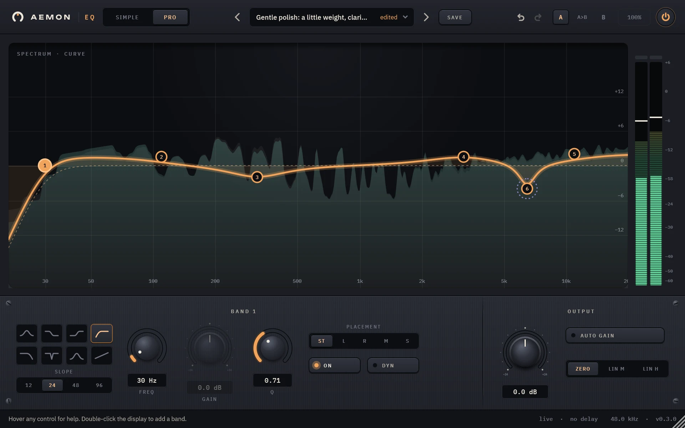

# Aemon

**Four free, open-source plugins for mixing and mastering.** Utility, EQ, Compressor and Limiter, as VST3 for Windows.
No account, no trial, no limits.

**[Website, with before and after clips](https://aemon-audio.github.io)** · **[Download for Windows](https://github.com/aemon-audio/aemon/releases/latest/download/Aemon-Suite-Setup.exe)** · **[User guide](https://aemon-audio.github.io/guide.html)**



| | |
| --- | --- |
| **Utility** | Level, width, pan, mono, polarity, mid/side, bass mono, loudness and phase. Bit-exact at its defaults. |
| **EQ** | 16 bands that match the analogue curve up to 20 kHz. Dynamic bands, mid/side, zero latency or linear phase. |
| **Compressor** | Clean compression, auto release, lookahead, external side-chain, parallel mix, level matched for you. |
| **Limiter** | True peaks that hold, loudness targets, "Make it loud safely", equal-loudness compare, dither. |

Every plugin has **Simple** (a few big controls, live checks in plain words, one-click fixes) and **Pro** (everything).
They share the same settings, so switching never changes the sound. 132 presets say what they do.

## Install
1. Close your DAW and run `Aemon-Suite-Setup.exe`.
2. "Windows protected your PC": choose **More info**, then **Run anyway**.
3. "Allow this app to make changes to your device?": choose **Yes**.
4. Tick the plugins you want, press **Install**, and scan for new plugins in your DAW.

Windows asks because Aemon is **not signed yet**. [What the two messages mean](https://aemon-audio.github.io/#install). Signing is coming soon.
To check your download, compare it with `SHA256SUMS.txt` in the [release](https://github.com/aemon-audio/aemon/releases/latest).

This is an early release. It is tested by machine and in use, but please
[report anything that sounds or behaves wrong](https://github.com/aemon-audio/aemon/issues).

Windows 10 or 11, 64-bit, any VST3 host. A Mac version is planned.

## Measured
Every build runs the audio tests in `tests/` and [pluginval](https://github.com/Tracktion/pluginval) at strictness 10. Some results:

- Utility, EQ and Compressor at neutral, and the Limiter below its ceiling: bit-exact, 44.1 to 192 kHz.
- EQ: a +9 dB bell at 13 kHz (48 kHz) stays within 0.2 dB of the analogue curve. The textbook filter is 4.4 dB off.
- Limiter: with a −1.0 dBTP ceiling, the highest reading of an ITU-R BS.1770 meter over 1,296 setups was −1.01 dBTP.
- Loudness meter within 0.01 LU on a reference tone.

## Build it yourself
You need CMake 3.22 or newer and Visual Studio 2022 (C++). JUCE is downloaded automatically.

```powershell
cmake -S . -B build -G "Visual Studio 17 2022" -A x64
cmake --build build --config Release --target AemonUtility_VST3 AemonEQ_VST3 AemonCompressor_VST3 AemonLimiter_VST3
```

The plugins are in `build\plugins\<name>\...\Release\VST3`. The engines in `plugins/*/Source/*Engine.h` have no
dependencies (except Utility's) and can be tested on their own. See [CONTRIBUTING](CONTRIBUTING.md).

## Licence
[GNU AGPL v3 or later](LICENSE). What you make with the plugins is yours. Built with [JUCE](https://juce.com). Third-party
notices are in [THIRD-PARTY.txt](installer/windows/THIRD-PARTY.txt). VST is a trademark of Steinberg Media Technologies GmbH.

Made for the love of the game.
